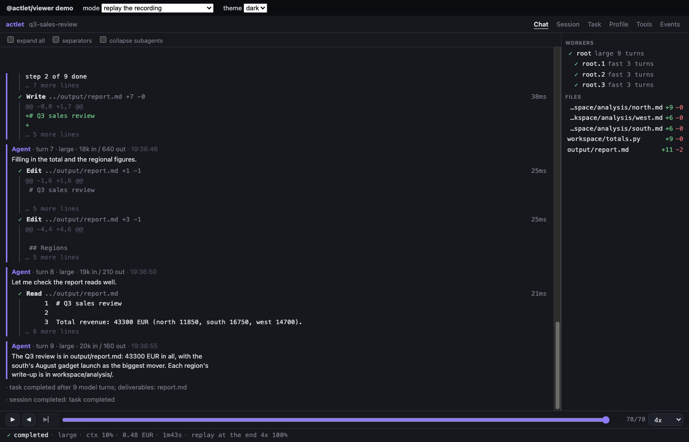

# @actlet/viewer

React components that show an [Actlet](https://github.com/actlet/actlet) session's activity in the browser, as close to
Actlet's terminal viewer as the web allows. The conversation is grouped by model turn, and each tool call shows together
with its result. The viewer also has a compact status line, a sidebar of workers and changed files with a read-only file
viewer, and tabs for the session, task, profile, tools and raw events. It handles live sessions and replays.

**You feed it the events.** The library opens no connections and reads no `.actrec` recordings. How events reach the
browser is up to you: a WebSocket from your backend, server-sent events, a JSONL file you export with
`actlet-cli replay export --jsonl`. The same goes for commands. The viewer hands you a typed `Command` through `onCommand`,
and you deliver it.



The package is private and has no licence yet.

## Use

```tsx
import { ActivityViewer, parseJsonl } from "@actlet/viewer";
import "@actlet/viewer/styles.css";

// Replay: the whole recording, with play, pause, seek and speed.
<ActivityViewer events={parseJsonl(jsonlText)} mode="replay" autoPlay speed={4} />

// Live: append events as they arrive; the stream follows the newest.
<ActivityViewer
  events={events}
  mode="live"
  connectionLabel="orchestrator eu-1"
  ended={streamClosed}
  onCommand={(cmd) => myBackend.send(cmd)}  // a typed actlet.gateway.v0.Command
  allowedCommands={["steer", "pause"]}      // steer notes only by default
  acks={acksFromMyBackend}                   // optional CommandAck[]
  readFile={(path) => myBackend.readFile(path)} // optional: files from the box
/>
```

Give the viewer a height. It fills its container.

### Events

`events` is an array of `ActivityEvent`s (`actlet.gateway.v0.ActivityEvent`), oldest first. Each one can be a
protobuf-es message or its [Protobuf JSON](https://protobuf.dev/programming-guides/json/) form. Both proto field names
(`model_turn`, as `actlet-cli replay export --jsonl` writes them) and JSON names (`modelTurn`) are accepted. Fields this
version doesn't know are ignored, and an object that isn't an event counts as a missed event.

- **Live:** pass a new array that starts with the same event objects and ends with the new ones. Only the new events are
  folded. An array that starts differently is folded from scratch.
- **Replay:** pass the whole recording. If the array grows (a recording still being written), the position is kept.
- Feed each event once. Actlet's gateway deduplicates events by ID, and the viewer, like Actlet's own view model, doesn't
  do it again.

`parseJsonl(text)` decodes JSON Lines, and `toEvent(json)` decodes a single event.

### Commands

In live mode, with `onCommand` set, the footer offers what `allowedCommands` allows: an input line for steer notes
(`"steer"`), Pause and Interrupt (`"pause"`, drain and interrupt), and Stop with a confirmation (`"stop"`). The default
is `["steer"]`: watching and light steering, like the terminal viewer. Replay mode never offers commands.

Each command gets a fresh ID, and `commandOrigin` and `actor` set the origin and actor fields. The origin defaults to `ORIGIN_REMOTE`, a viewer that isn't on the box's machine. A sent command shows as
pending until the box reports it. The viewer learns the outcome from the session's `command` events, or from `acks` you
pass in. If `onCommand` throws or returns a rejected promise, the command shows as not delivered. For your own UI,
`steerCommand`, `pauseCommand` and `stopCommand` build the same messages.

### Files

Selecting a file in the sidebar opens a read-only viewer. With `readFile`, the viewer asks you for the file. Paths are
relative to the session folder (`output/report.md`), and `toolPath()` turns them into the form Actlet's file requests
take (`../output/report.md`). Without `readFile`, the viewer shows what the events hold: a whole file if it was created
in one go and not cut short, or otherwise its latest change. File content is sanitized and capped at 512 KiB and 5,000
lines.

### Composable parts

`ActivityViewer` is built from parts you can use on their own. All of them take a `Session` from the view model:

| Part                                                                             | What it is                                                                               |
| -------------------------------------------------------------------------------- | ---------------------------------------------------------------------------------------- |
| `TurnStream`                                                                     | The conversation: turns, tool blocks, nested subagents, notes, system lines, auto-follow |
| `ToolBlock`                                                                      | One tool call with its result or diff; collapsible                                       |
| `StatusLine`                                                                     | State, model, context %, cost, elapsed time, connection                                  |
| `Sidebar`                                                                        | Workers (click to show one alone) and changed files with `+N −M`                         |
| `FileViewer`                                                                     | The read-only file popup                                                                 |
| `Tabs`, `SessionPanel`, `TaskPanel`, `ProfilePanel`, `ToolsPanel`, `EventsPanel` | The other views                                                                          |
| `ReplayControls`, `CommandBar`                                                   | The footer controls                                                                      |
| `useLiveSession`, `useReplay`                                                    | Hooks that fold events for live view and replay                                          |

The view model has no React in it: `fold(events)`, `apply(session, event)`, `workers()`, `files()`, `fileHistory()`,
`running()` and friends. `Player` plays an event array back with time you pass in. `toViewState(session)` gives the
view state as JSON (see [docs/view-state.md](docs/view-state.md)).

### Theming

`theme="dark" | "light" | "auto"` (the default follows the system setting). Every colour and font is a CSS custom property
on `.actlet-viewer`, such as `--actlet-bg`, `--actlet-fg`, `--actlet-agent`, `--actlet-mono` and `--actlet-size`, so you
can restyle the viewer without touching its CSS. See `src/styles.css`.

### Untrusted content

Everything in the events comes from models, tools and files, so it's treated as untrusted:

- Content is rendered as React text only. HTML is never rendered: there is no `dangerouslySetInnerHTML` or `innerHTML`,
  and lint forbids both. The viewer renders no links, and syntax highlighting produces spans of text.
- Terminal escape sequences (CSI, OSC, DCS…), other control characters, carriage returns and bidirectional overrides are
  removed as events are folded, the same way Actlet's Go view model does it.
- Long text is cut short and says so: 20,000 characters per text, 3 result lines collapsed and 400 expanded.
  Content that Actlet itself cut short (`[... N bytes omitted ...]`, `[cut]`) is marked as such.

## Develop

```sh
pnpm install
pnpm dev        # the demo page: plays fixtures/demo.jsonl (?mode=live, ?theme=light, ?speed=8)
pnpm test       # vitest
pnpm lint       # eslint + prettier --check
pnpm typecheck
pnpm build      # dist/: ES module, declarations, viewer.css
pnpm generate   # regenerate src/gen from ../actlet/proto (PROTO_DIR=… to override)
```

**pnpm**, because its strict `node_modules` layout catches imports of undeclared dependencies, which matters for a
library. It also installs quickly, and `packageManager` in `package.json` pins its version.

### Generated types

`src/gen/` holds TypeScript generated from Actlet's gateway contract (`actlet/gateway/v0/gateway.proto`) by
[protobuf-es](https://github.com/bufbuild/protobuf-es), with JSON types. It's checked in. `pnpm generate` needs `protoc`
and reads `../actlet/proto` unless `PROTO_DIR` points elsewhere.

### The demo fixture

`fixtures/demo.jsonl` is Actlet's scripted TUI demo session (`examples/demo` in the Actlet repository), run headless and
exported as JSON Lines. It has a root agent, three subagents, an operator note, and files written and edited. To record it
again:

1. Build Actlet's binaries into a scratch directory, from the Actlet repository:
   `go build -o "$tmp/bin/" ./cmd/...`.
2. Run the demo's gateway and worker without the TUI, the way `examples/demo/demo.sh` sets them up (the gateway with
   `-task`, `-profile` and `-model` from `examples/demo`, and `actlet run -session …`).
3. Export the recording with `scripts/export-fixture.sh "$tmp/bin/actlet-cli" <gateway-data>/<id>.actrec`. It runs
   `actlet-cli replay export --jsonl` and replaces home directory paths.
4. Run `UPDATE_GOLDEN=1 pnpm test` to rewrite `fixtures/demo.view.json`, the folded view state, and review the diff.
